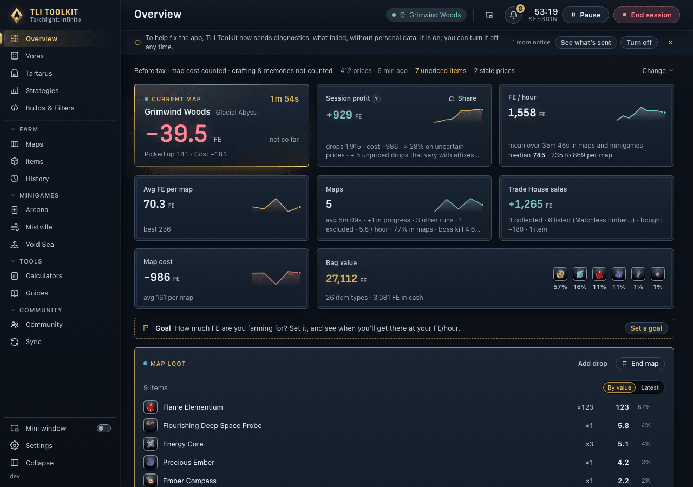

# TLI Toolkit

An all-in-one companion app for **Torchlight: Infinite**: a farming tracker, minigame advisors with on-game
highlights, calculators and guides, and a small always-on-top window you keep over the game.

**[Download the latest version](https://github.com/SheF1k/tli-toolkit-releases/releases/latest)** (Windows) ·
**[Website, guides and FAQ](https://tlitoolkit.com)**

## What it does

- **Farming tracker.** Reads the game's log to track every map: what dropped (with item icons), what opening the map
  cost, your profit and your **FE per hour** (real time and in maps, after tax if you like), valued with live
  community prices. Charts, your bag's value with price trends, results per map, per day and per season, Auction
  House sales, crafting and Memory Revival costs, and Vorax, Tartarus, Sandlord and Void Sea runs on their own rows.
  Pause, continue a session, and compare your setups (compasses, Pactspirits, Void Chart) in **Strategies**.
- **Minigame advisors:** Vorax, Tartarus Prison, Arcana, Mistville and Void Sea. They play your options out thousands
  of times and show the best move, ringed directly over the game. Vorax and Tartarus can **read the board from the
  game window** (new, being tested), so there's less to type.
- **Mini window.** A small always-on-top widget you drag over the game and resize: live FE/hour, session stats, the
  current map, the latest drops, and the move to make in minigames. Click-through lock, timers, and an OBS source.
- **Calculators and guides:** Memory Revival, Cube Greed, TOWER Sequence, crafting vs buying, the Divinity board, a
  builds and loot-filter library, and guides for Sandlord, Clockwork Roulette, Frozen Canvas and Maze City.

## Download

1. Open the [latest release](https://github.com/SheF1k/tli-toolkit-releases/releases/latest).
2. Download `TLI-Toolkit-<version>.exe` under **Assets**.
3. Run it. It's portable: there is nothing to install. To update, use **Update and restart** when the app says a new
   version is out (or Settings → Updates; pick **Beta** there for test builds). It checks the download against the
   SHA-256 published with the release and keeps the old exe until the new one starts.

**On 0.1.0-beta.11 or older?** Its update button can't install the new version. Quit TLI Toolkit from the tray
(right-click its icon → Quit), then open the new exe you downloaded.

Windows 10 or 11 (64-bit) only. Keep the exe somewhere other than OneDrive, Program Files or a zip you opened: updates
can't replace it there.

The app isn't code-signed, so Windows SmartScreen may say "Windows protected your PC" the first time. Click
**More info**, then **Run anyway**. Each release lists the exe's SHA-256, so you can check your download in PowerShell
with `Get-FileHash .\TLI-Toolkit-<version>.exe`.

## First steps

1. **Press Enable Log in the game:** in Torchlight: Infinite, press **Esc → Settings → Other** and, under **Account Related**, press the
   **Enable Log** button. The game turns logging off every time it starts, so press it again after each launch.
2. **Relog** (back to character selection and in again), so the game writes your character and bag to the log.
3. **Sort your bag once**, so the tracker knows every stack you're carrying.
4. **Start TLI Toolkit.** It finds the log by itself (Steam, the launcher or TapTap): the top bar says **Game log
   connected**, and the **Get tracking** card ticks off **Game logging is on** once Enable Log worked. The Setup check
   tells you if something is off.

Now farm as usual: every map shows up on the **Overview**. When you open a minigame, the app switches to its advisor.

## FAQ

**Is it safe? Can I get banned?**
TLI Toolkit reads the game's log file (which the game writes itself once you press Enable Log). To find it, it looks in the
game's install folders. For the on-game highlights it asks Windows where the game window is, and for screen reading it
captures **only the game window**, only while an advisor's Auto-read is on (or you press Read now), and reads it on
your PC: pictures are never saved or sent. It does not read or change the game's memory, inject anything into the game,
or click and type for you: every move is still yours. It is an unofficial tool, though, so use it at your own risk.

**Why is there no source code here?**
TLI Toolkit is closed source. This repository only hosts the downloads, the release notes and the bug reports.

**What goes online?**
The price feed, the update check, the release notes and the patch status
([tlitoolkit.com/status.json](https://tlitoolkit.com/status.json): which parts of the app work with the current game
patch, also on [tlitoolkit.com/status](https://tlitoolkit.com/status)). Nothing about you or your runs is sent with them.

Only if you turn it on (Settings → Community), and asked once, never on by default:
- **Share my runs:** finished maps, anonymously, for the community farming tables on the website (zone, time, what
  dropped and what opening it cost, your Pactspirits and Void Chart), plus a once-a-day check-in that a copy is running
  (version and language only).
- **Share minigame runs:** your Vorax and Tartarus decisions (the boards, the advice shown, your pick, the result), to
  improve the advisors.

Both use a random id, never your character or account name; **See exactly what's sent** shows it, and **Delete my
data** removes it. Details: [Safety & privacy](https://tlitoolkit.com/about).

**Where do the prices come from?**
Community prices from [tlicompanion.com](https://tlicompanion.com), plus the prices you look up on the in-game
exchange. You can set any price by hand, or switch the price feed off in Settings.

**Does it work on Mac, Linux, Steam Deck or phones?**
No, Windows only.

## Credits

TLI Toolkit stands on the work of others:

- **Moebing's Vorax simulator** (MIT): the base rules of the Vorax simulation.
- **[DinoRaos/vorax-solver-rs](https://github.com/DinoRaos/vorax-solver-rs)** (MIT): Vorax screen layouts and test frames.
- **[glcoder/TartarusSolver](https://github.com/glcoder/TartarusSolver)** (MIT): the Tartarus Prison solver the
  advisor is built on, and its screen layouts.
- **[Syncingoutt/Fenix](https://github.com/Syncingoutt/Fenix)** (MIT): zone and item names.
- **[GeorgeTG/Oracle](https://github.com/GeorgeTG/Oracle)** (MIT): map names.
- **[Tyrayla/TLIBuilder](https://github.com/Tyrayla/TLIBuilder)** (MIT): the log's character and Pactspirit layout.
- **[tesseract.js](https://github.com/naptha/tesseract.js)** (Apache 2.0): text reading for the screen reader.
- **[tidewarden/vorax-solver](https://github.com/tidewarden/vorax-solver)**: the reference for Vorax rules and odds.
- **[tlicompanion.com](https://tlicompanion.com)**: community prices. **[tlidb.com](https://tlidb.com)**: item icons (fan-made, not affiliated with XD). Game art © XD.

TLI Toolkit is a fan-made tool. It is not affiliated with or endorsed by the makers of Torchlight: Infinite.

## Reporting bugs

Found a bug or have an idea? Press **Ctrl+Alt+B** in the app to put together a report, or
[open an issue](https://github.com/SheF1k/tli-toolkit-releases/issues) (or email [hello@tlitoolkit.com](mailto:hello@tlitoolkit.com)) and include:

- the version you're running (Settings → About, or the exe's file name),
- what you did, what you expected and what happened instead,
- a screenshot if it helps.

For tracker problems, the relevant part of the game's log helps a lot (the Settings tab shows where the file is).
Note that the log contains your character name.
